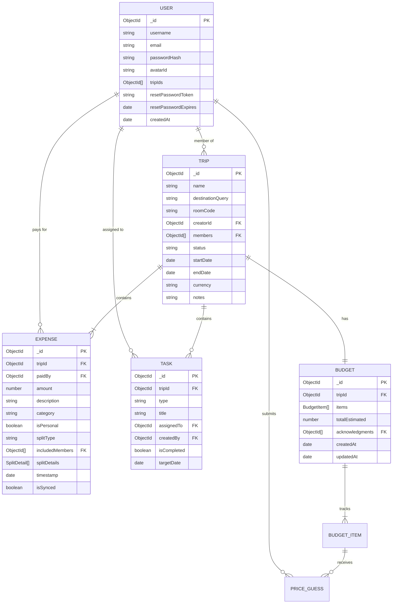
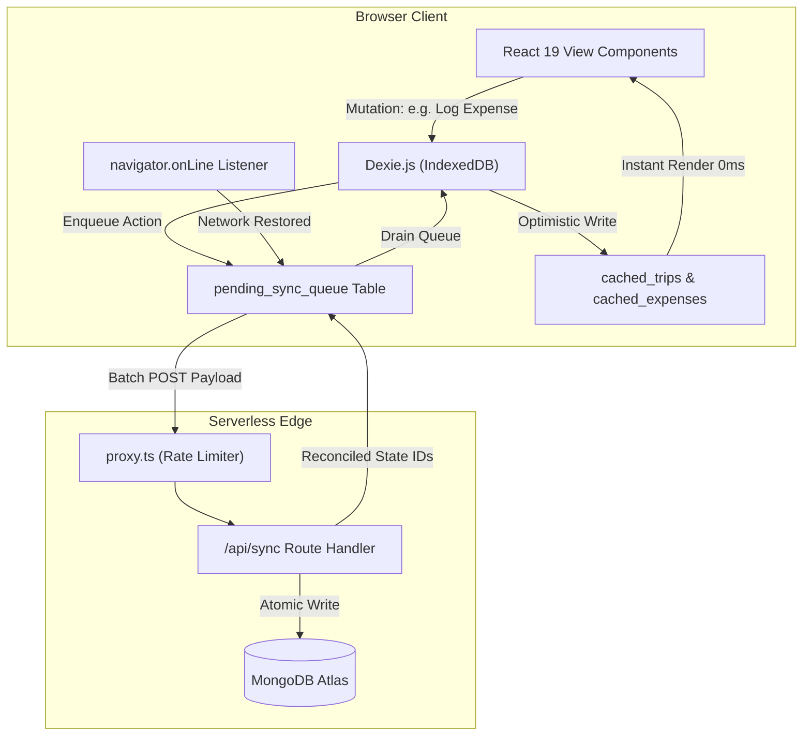

# System Design Document

**Project:** TripSplit — Collaborative Group Travel Organizer & Budgeting PWA  
**Version:** 1.1.1  
**Architecture Style:** Modular Monolith (Next.js 16 App Router)  
**Target Cost:** $0/month (Free-Tier Production Stack)

---

## 1. Core Infrastructure & Technology Stack

| Layer | Technology | Role & Justification |
| :--- | :--- | :--- |
| **Framework** | Next.js 16.4.3 (App Router) | Full-stack framework leveraging React 19 Server Components, Turbopack, and Cache Components for high-performance rendering. |
| **Styling** | Tailwind CSS v4 | Zero-runtime CSS engine with native `@theme` CSS custom properties for the "Ethereal Sanctuary" palette. |
| **Edge Proxy** | `proxy.ts` | Next.js 16 standard proxy replacing deprecated middleware; enforces in-memory IP rate limiting on sensitive auth endpoints. |
| **Hosting** | Vercel (Hobby Tier - Free) | Automated CI/CD, edge distribution, and serverless route execution. |
| **Cloud Database** | MongoDB Atlas (M0 Free Sandbox) | Document storage with 512 MB capacity, replica set fault tolerance, and Mongoose connection caching. |
| **Authentication** | Auth.js / NextAuth v5 | Stateless JWT sessions validated against live MongoDB user state to prevent ghost sessions. |
| **Offline Storage** | Dexie.js v4 (IndexedDB) | Browser-native structured database supporting offline data queuing and optimistic UI updates. |

---

## 2. Storage & Zero-Cost Optimization Strategy

To maintain $0/month operational costs without hitting serverless timeouts or storage quotas:
* **Zero Binary Storage**: The backend strictly avoids binary file uploads (no S3/GCS buckets required).
* **Dynamic Photography**: Destination cover photos are resolved client-side via the Unsplash API using query strings (e.g., `Interlaken, Switzerland`), caching URLs in the browser.
* **Predefined Avatars**: User profiles use lightweight flat-design SVG avatars stored statically in `/public`.
* **External Media Links**: Group photos and documents are supported via external hyperlinks (Google Drive, iCloud, Dropbox) saved in Trip Notes.

---

## 3. Database Architecture (Mongoose / MongoDB)



### 3.1 User Schema (`lib/db/models/User.ts`)
* `_id`: ObjectId (Primary Key)
* `username`: String (Required, trimmed)
* `email`: String (Required, unique, lowercase, indexed)
* `passwordHash`: String (Bcrypt salted hash)
* `avatarId`: String (Default: `'avatar-fox.svg'`)
* `tripIds`: `[{ type: ObjectId, ref: 'Trip' }]`
* `resetPasswordToken`: String (Nullable, for password recovery)
* `resetPasswordExpires`: Date (Nullable, token expiration)
* `createdAt`: Date (Default: `Date.now`)

### 3.2 Trip Schema (`lib/db/models/Trip.ts`)
* `_id`: ObjectId (Primary Key)
* `name`: String (Required)
* `destinationQuery`: String (Required, used for Unsplash query)
* `roomCode`: String (Required, unique, uppercase, 6 characters, indexed)
* `creatorId`: ObjectId (Ref: `'User'`, Required)
* `members`: `[{ type: ObjectId, ref: 'User' }]`
* `status`: String (Enum: `'active'`, `'completed'`, Default: `'active'`)
* `startDate`: Date (Required)
* `endDate`: Date (Required)
* `currency`: String (Default: `'INR'`, supported: `USD, EUR, GBP, INR, CAD, AUD, JPY`)
* `notes`: String (Default: `''`)

### 3.3 Expense Schema (`lib/db/models/Expense.ts`)
* `_id`: ObjectId (Primary Key)
* `tripId`: ObjectId (Ref: `'Trip'`, Required, indexed)
* `paidBy`: ObjectId (Ref: `'User'`, Required)
* `amount`: Number (Required)
* `description`: String (Required)
* `category`: String (Default: `'Misc'`)
* `isPersonal`: Boolean (Default: `false`)
* `splitType`: String (Enum: `'equal'`, `'exact'`, `'percentage'`, `'personal'`, Default: `'equal'`)
* `includedMembers`: `[{ type: ObjectId, ref: 'User' }]`
* `splitDetails`: `[{ userId: ObjectId, amountOwed: Number }]`
* `timestamp`: Date (Default: `Date.now`)
* `isSynced`: Boolean (Default: `true`)
* **Compound Index**: `{ tripId: 1, timestamp: -1 }` for high-speed chronological ledger retrieval.

### 3.4 Budget Schema (`lib/db/models/Budget.ts`)
* `_id`: ObjectId (Primary Key)
* `tripId`: ObjectId (Ref: `'Trip'`, Required, unique, indexed)
* `items`: Array of embedded `BudgetItemSchema`:
  * `title`: String (Required)
  * `category`: String (Enum: `'Stay'`, `'Transport'`, `'Food & Dining'`, `'Activities'`, `'Shopping'`, `'Misc'`)
  * `addedBy`: ObjectId (Ref: `'User'`, Required)
  * `guesses`: Array of embedded `PriceGuessSchema`:
    * `userId`: ObjectId (Ref: `'User'`, Required)
    * `amount`: Number (Required)
    * `notes`: String
    * `updatedAt`: Date
  * `consensusCost`: Number (Calculated median/mean across traveler guesses)
  * `agreedCost`: Number (Nullable, populated when locked)
  * `isLocked`: Boolean (Default: `false`)
  * `createdAt`: Date
* `totalEstimated`: Number (Computed sum of all line item effective costs)
* `acknowledgments`: `[{ type: ObjectId, ref: 'User' }]` (Travelers who approved the current per-person share)
* `createdAt` / `updatedAt`: Date

### 3.5 Task Schema (`lib/db/models/Task.ts`)
* `_id`: ObjectId (Primary Key)
* `tripId`: ObjectId (Ref: `'Trip'`, Required, indexed)
* `type`: String (Enum: `'milestone'`, `'errand'`, `'gear'`, Required)
* `title`: String (Required)
* `assignedTo`: ObjectId (Ref: `'User'`, Nullable)
* `createdBy`: ObjectId (Ref: `'User'`, Nullable)
* `isCompleted`: Boolean (Default: `false`)
* `targetDate`: Date (Nullable)
* **Compound Index**: `{ tripId: 1, type: 1, isCompleted: 1 }`

---

## 4. Offline Sync Architecture (Dexie.js / IndexedDB)



### Client Database Schema (`lib/dexie/db.ts`)
* **Database Name**: `tripsplit-db`
* **Tables**:
  * `pending_sync_queue`: Key: `++id`, Indexed on `type`, `createdAt`
  * `cached_trips`: Key: `id`, Indexed on `updatedAt`
  * `cached_expenses`: Key: `id`, Indexed on `tripId`, `updatedAt`

---

## 5. Debt Simplification Algorithm ($O(N)$ SettleUp)

Group expenses often produce circular debts (e.g., A owes B, B owes C, C owes A). TripSplit resolves this using a greedy net-balance reduction algorithm in `lib/utils/settleUp.ts`:

### Mathematical Formulation
1. **Net Balance Calculation**: For each member $i \in M$:
   $$\text{Balance}_i = \sum \text{Paid By } i - \sum \text{Owed By } i$$
   Members with $\text{Balance} > 0$ are **creditors** (owed money); members with $\text{Balance} < 0$ are **debtors** (owe money). The sum of all net balances $\sum \text{Balance}_i = 0$.
2. **Greedy Matching**:
   * Sort creditors descending by amount owed.
   * Sort debtors ascending by debt magnitude.
   * In each step, match the largest debtor with the largest creditor:
     $$\text{Transfer} = \min(|\text{Debt}|, \text{Credit})$$
   * Settle the transfer, update remaining balances, and remove settled parties.
3. **Complexity & Result**: Runs in $O(N \log N)$ due to sorting and generates at most $N - 1$ transactions, eliminating redundant interpersonal cash transfers.

---

## 6. Directory Structure (App Router)

```text
TripSplit/
├── app/
│   ├── api/
│   │   ├── auth/            # NextAuth & Password Recovery
│   │   ├── budget/          # Guessing Hub, Locking, Acknowledgments
│   │   ├── expenses/        # Ledger CRUD & Participant Toggles
│   │   ├── register/        # Account Creation
│   │   ├── sync/            # Offline Batch Sync
│   │   ├── tasks/           # Logistics, Errands & Gear
│   │   └── trips/           # Trips & Room Code Join
│   ├── dashboard/           # User Master Dashboard
│   ├── trip/[id]/
│   │   ├── overview/        # Tab 1: Status & Milestones
│   │   ├── money/           # Tab 2: Finance & Dual Budget Hub
│   │   ├── plan/            # Tab 3: Day-by-Day Timeline
│   │   └── tasks/           # Tab 4: Packing & Errands
│   ├── globals.css          # Tailwind CSS v4 & Theme Tokens
│   └── layout.tsx           # PWA Viewport & Shell Layout
├── assets/                  # High-Resolution Documentation Vector Graphics
├── Doc/                     # Official Engineering Specifications
│   ├── APIDesign.md         # Complete REST Endpoint Specification
│   ├── PRD.md               # Product Requirements Document
│   └── SystemDesign.md      # Architecture, Schemas & Algorithms
├── lib/
│   ├── auth.ts              # NextAuth v5 Configuration & Session Checks
│   ├── db/
│   │   ├── mongoose.ts      # Singleton Mongoose Connection
│   │   └── models/          # User, Trip, Expense, Budget, Task
│   ├── dexie/
│   │   ├── db.ts            # Dexie.js Client Database
│   │   └── sync.ts          # Client Sync Dispatcher
│   └── utils/
│       ├── currency.ts      # Multi-Currency Formatter
│       ├── rateLimit.ts     # In-Memory Sliding-Window Rate Limiter
│       └── settleUp.ts      # O(N) Debt Simplification Graph Engine
├── proxy.ts                 # Next.js 16 Edge Proxy (IP Rate Limiting)
├── public/                  # Static Avatars, Web App Manifest & App Icons
├── CHANGELOG.md             # Chronological Version Release Notes
├── CONTRIBUTING.md          # Open-Source Contribution Guide
├── LICENSE                  # MIT License
├── README.md                # Master Repository Documentation
└── SECURITY.md              # Vulnerability Disclosure Policy
```
