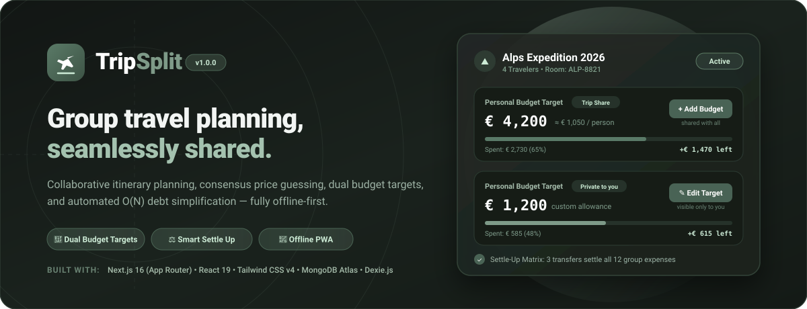
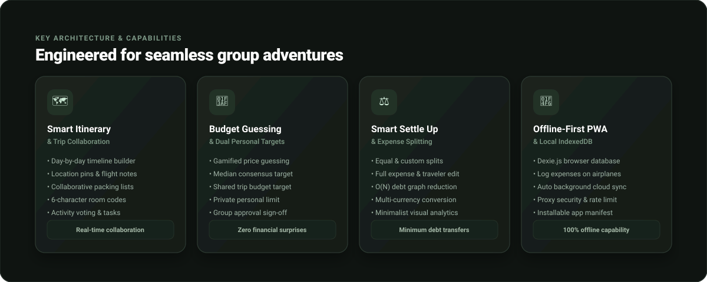
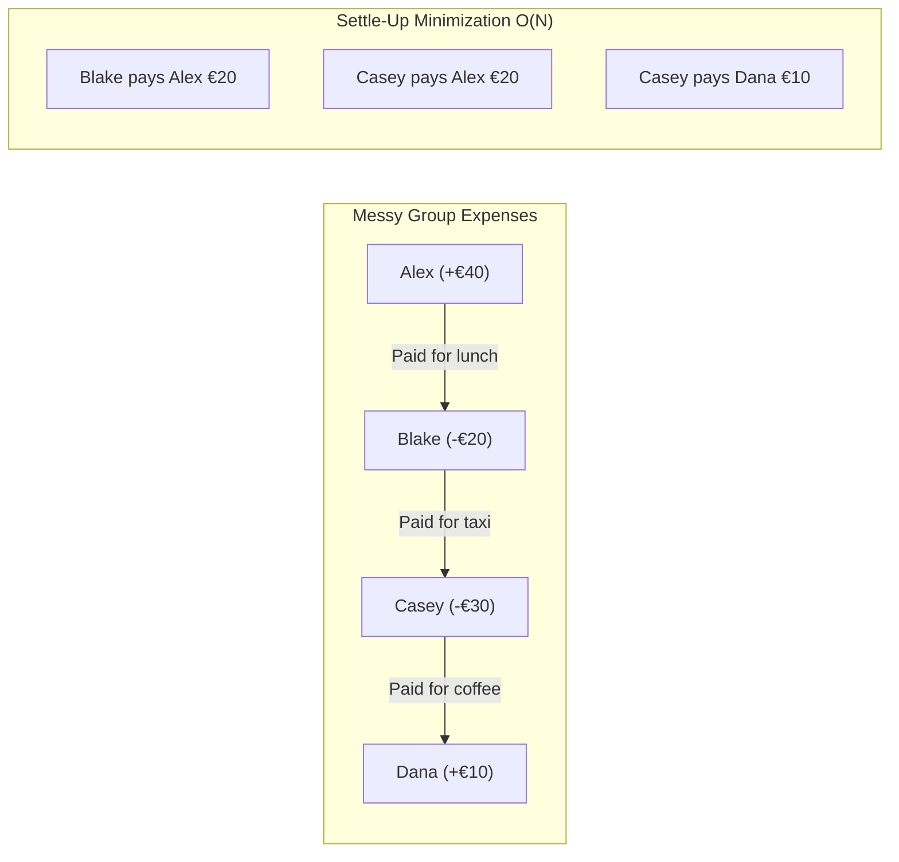
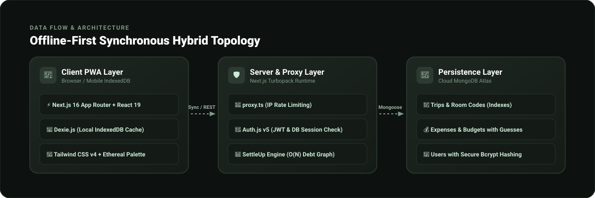
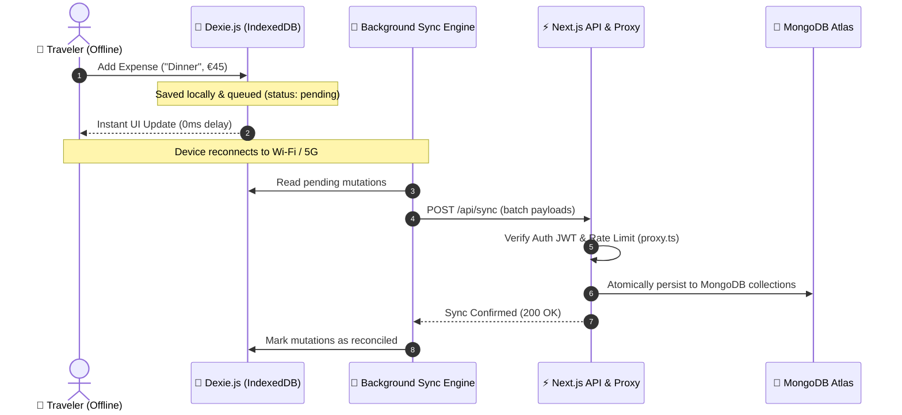

<div align="center">

  

  <br />

  <p align="center">
    <strong>A collaborative group travel planner, consensus budget guessing game, and smart expense splitting app.</strong>
    <br />
    <em>Engineered with offline-first local storage, dual budget ceilings, and automated debt graph reduction.</em>
  </p>

  <p align="center">
    <a href="#key-features"></a>
    <a href="https://nextjs.org/"></a>
    <a href="https://react.dev/"></a>
    <a href="https://tailwindcss.com/"></a>
    <a href="https://dexie.org/"></a>
    <a href="https://www.mongodb.com/"></a>
    <a href="LICENSE"></a>
  </p>

  <p align="center">
    <a href="#-quick-start">Quick Start</a> •
    <a href="#-key-features">Key Features</a> •
    <a href="#-dual-budget-targets">Dual Budget Targets</a> •
    <a href="#-smart-debt-settle-up">Smart Settle-Up</a> •
    <a href="#-offline-first-architecture">Offline Sync</a> •
    <a href="CHANGELOG.md">Changelog</a>
  </p>

</div>

---

## 📖 Table of Contents

- [Why TripSplit?](#-why-tripsplit)
- [Key Features](#-key-features)
  - [1. Collaborative Trip Itinerary & Packing](#1-collaborative-trip-itinerary--packing)
  - [2. Price Guessing & Consensus Budgeting](#2-price-guessing--consensus-budgeting)
  - [3. Dual Personal Budget Targets](#3-dual-personal-budget-targets)
  - [4. Expense Splitting & Participant Control](#4-expense-splitting--participant-control)
  - [5. Smart Debt Simplification Algorithm](#5-smart-debt-simplification-algorithm)
  - [6. Minimalist Spending Analytics](#6-minimalist-spending-analytics)
- [Offline-First Architecture & Sync](#-offline-first-architecture--sync)
- [Tech Stack](#-tech-stack)
- [Quick Start](#-quick-start)
- [Environment Configuration](#-environment-configuration)
- [Project Directory Structure](#-project-directory-structure)
- [Contributing & Roadmap](#-contributing--roadmap)
- [License](#-license)

---

## 🌟 Why TripSplit?

Planning a trip with friends often devolves into chaotic spreadsheets, lost receipts, awkward balance inquiries, and misaligned spending expectations.

**TripSplit** fixes group travel finances from the ground up:
1. **Before the Trip**: Gamified **Price Guessing** lets travelers estimate costs together and discover the median consensus before booking expensive reservations.
2. **During the Trip**: Log shared expenses in any currency, split them equally or selectively, and track out-of-pocket spending **100% offline** on flights or remote mountain trails.
3. **After the Trip**: The **Smart Settle-Up Engine** analyzes all net balances using an optimized $O(N)$ debt minimization graph, reducing dozens of messy interpersonal payments to the absolute bare minimum number of transfers.

---

## 🚀 Key Features

<div align="center">
  
</div>

### 1. Collaborative Trip Itinerary & Packing
- **6-Character Room Codes**: Invite friends to join your trip room in seconds (e.g. `ALP-8821`).
- **Interactive Timeline**: Plan activities day-by-day with start times, location tags, and traveler assignments.
- **Shared Packing List**: Ensure nobody forgets essentials with real-time shared checklist toggles.

### 2. Price Guessing & Consensus Budgeting
- **Gamified Estimations**: Before booking villas or adventure tours, everyone submits their price guess.
- **Consensus Median**: Automatically calculates the statistical median guess across the group to remove outliers.
- **One-Click Target Lock**: Lock agreed estimates into official trip budget line items with group sign-off.

### 3. Dual Personal Budget Targets
TripSplit eliminates the friction between group expenses and individual spending limits with two symmetrical cards:

| Card | Target Type | Scope | How It Works |
| :--- | :--- | :--- | :--- |
| **Trip Share** | Shared Group Share | 👥 Shared with all | Derives your exact per-person share from the collaborative group budget. Features a 1-click group approval button (`✓ Approved X/Y`). |
| **Private Allowance** | Personal Spending Ceiling | 🔒 Private to you | Set a personal out-of-pocket limit only you can see, preventing you from overspending regardless of group decisions. |

Both cards share an identical high-clarity layout featuring:
- **Big bold font-mono currency metrics**
- **Visual scale tracks with `$0`, `50%`, and `Target Ceiling` ticks**
- **Real-time color-coded spend & remaining indicators (green for under budget, amber at 80%, crimson when exceeded)**

### 4. Expense Splitting & Participant Control
- **Dynamic Participant Toggle**: Splitting dinner where one person didn't drink alcohol? Easily toggle specific travelers on or off with instant recalculation.
- **Full Expense Editing**: Edit amounts, payers, descriptions, and participant groups at any time.
- **Multiple Currencies**: Seamlessly format across `USD`, `EUR`, `GBP`, `INR`, `CAD`, `AUD`, and `JPY`.

### 5. Smart Debt Simplification Algorithm
Instead of traveler A paying traveler B, traveler B paying traveler C, and traveler C paying traveler A, TripSplit computes the **net balance** for every traveler and resolves the minimum cash transfer graph:



### 6. Minimalist Spending Analytics
- **Donut Health Ring**: Minimalist visual dial showing percentage of overall target budget consumed.
- **Paired Category Bars**: Compare estimated budget vs actual spend across Stays, Food, Activities, and Transport.
- **Traveler Net Matrix**: Instant view of who is owed money and who has outstanding debt.

---

## 📶 Offline-First Architecture & Sync

<div align="center">
  
</div>

TripSplit is built for actual travel conditions — including airplanes, ferries, and remote locations with zero cellular reception:

1. **Client Persistence (IndexedDB + Dexie.js)**: Every trip, expense, and itinerary event is stored locally on the client's browser database.
2. **Optimistic Local UI**: Actions take effect instantly on screen without waiting for network round-trips.
3. **Automatic Cloud Sync**: As soon as internet connectivity returns, mutations in the offline queue are synced seamlessly to MongoDB via the `/api/sync` endpoint.



---

## 🛠️ Tech Stack

| Domain | Technology | Description |
| :--- | :--- | :--- |
| **Framework** | [Next.js 16](https://nextjs.org/) | App Router with Turbopack, Partial Prerendering & Cache Components |
| **Frontend UI** | [React 19](https://react.dev/) & [Tailwind CSS v4](https://tailwindcss.com/) | Modern UI components with custom "Ethereal Sanctuary" design palette |
| **Offline DB** | [Dexie.js](https://dexie.org/) | Browser IndexedDB wrapper supporting offline queries and transaction queues |
| **Cloud Database** | [MongoDB Atlas](https://www.mongodb.com/) & [Mongoose 9](https://mongoosejs.com/) | Document database with population, indexing, and strict schema validation |
| **Authentication** | [Auth.js / NextAuth v5](https://authjs.dev/) | Secure JWT sessions backed by active MongoDB user verification |
| **Security** | [proxy.ts & rateLimit](https://nextjs.org/) | In-memory IP-based rate limiting on sensitive authentication endpoints |
| **PWA** | Web App Manifest & Service Worker | Installable on iOS Safari and Android Chrome with standalone display |

---

## ⚡ Quick Start

### Prerequisites
- **Node.js** `v20.x` or `v22.x`
- **npm** `v10.x` or later
- **MongoDB** (local database or free [MongoDB Atlas](https://www.mongodb.com/atlas) connection URI)

### 1. Clone the repository
```bash
git clone https://github.com/your-username/tripsplit.git
cd tripsplit
```

### 2. Install dependencies
```bash
npm install
```

### 3. Configure environment variables
Create a `.env.local` file by copying the provided `.env.example`:
```bash
cp .env.example .env.local
```

Fill in your secrets:
```env
MONGODB_URI=mongodb+srv://<username>:<password>@cluster.mongodb.net/tripsplit?retryWrites=true&w=majority
AUTH_SECRET=your_32_byte_hex_secret_here
NEXTAUTH_SECRET=your_32_byte_hex_secret_here
NEXT_PUBLIC_UNSPLASH_ACCESS_KEY=optional_unsplash_key
```
*(Tip: generate a secure 32-byte secret with `openssl rand -hex 32`)*

### 4. Run the development server
```bash
npm run dev
```

Open [http://localhost:3000](http://localhost:3000) in your browser.

### 5. Build for production
```bash
npm run build
npm run start
```

---

## 🔐 Environment Configuration

| Variable | Required | Description |
| :--- | :---: | :--- |
| `MONGODB_URI` | **Yes** | Connection string for MongoDB (Atlas or local instance) |
| `AUTH_SECRET` | **Yes** | 32-byte secret used to sign Auth.js / NextAuth session tokens |
| `NEXTAUTH_SECRET` | **Yes** | Legacy NextAuth v4 compatibility secret key |
| `NEXTAUTH_URL` | Optional | Canonical URL of your app (e.g. `https://tripsplit.app`) |
| `NEXT_PUBLIC_UNSPLASH_ACCESS_KEY` | Optional | Unsplash Developer key for automatic trip destination cover photography |

---

## 📁 Project Directory Structure

```text
TripSplit/
├── app/
│   ├── api/
│   │   ├── auth/            # NextAuth credential callbacks & password reset
│   │   ├── budget/          # Budget items, price guesses, consensus locking
│   │   ├── expenses/        # CRUD operations for group expenses & splits
│   │   ├── sync/            # Offline-first reconciliation endpoint
│   │   ├── tasks/           # Shared packing lists and to-do items
│   │   └── trips/           # Trip rooms, room code generation, member join
│   ├── dashboard/           # User dashboard listing upcoming & past adventures
│   ├── trip/[id]/
│   │   ├── overview/        # Trip summary, destination banner & quick metrics
│   │   ├── money/           # Money Hub: Budget Guessing, Dual Targets & Analytics
│   │   ├── plan/            # Day-by-day itinerary & activity cards
│   │   └── tasks/           # Shared packing lists & checklist assignments
│   ├── globals.css          # Tailwind CSS v4 styling & Ethereal theme tokens
│   └── layout.tsx           # Root viewport & PWA meta configuration
├── assets/                  # High-resolution SVGs & visual graphics for GitHub
│   ├── hero-banner.svg
│   ├── features-preview.svg
│   └── architecture-diagram.svg
├── lib/
│   ├── auth.ts              # NextAuth v5 session configuration & DB checks
│   ├── db/
│   │   ├── mongoose.ts      # Cached Mongoose connection handler
│   │   └── models/          # Trip, User, Expense, Budget, and Task schemas
│   ├── dexie/
│   │   ├── db.ts            # IndexedDB schema configuration
│   │   └── sync.ts          # Client-side background sync coordinator
│   └── utils/
│       ├── currency.ts      # Multi-currency formatting & symbols
│       ├── rateLimit.ts     # IP-based sliding window rate limiter
│       └── settleUp.ts      # O(N) debt graph minimization algorithm
├── proxy.ts                 # Next.js 16 Edge proxy for route protection & rate limits
├── public/                  # Static icons, manifest.json & web app assets
├── CHANGELOG.md             # Version chronicle & release notes
├── CONTRIBUTING.md          # Contribution guidelines & coding conventions
├── LICENSE                  # MIT Open Source License
└── README.md                # Project documentation
```

---

## 🤝 Contributing & Roadmap

Contributions, ideas, and feature requests are welcome!

1. Check out [CONTRIBUTING.md](CONTRIBUTING.md) for local development workflows and guidelines.
2. Read [CHANGELOG.md](CHANGELOG.md) to explore the chronological summary of all updates and releases.
3. Review [SECURITY.md](SECURITY.md) to report vulnerabilities responsibly.

### 🗺️ Upcoming Roadmap
- [x] Export trip expenses, ledger breakdown, and settle-up reports to CSV.
- [ ] Export formatted trip expense reports to PDF.
- [ ] Real-time multi-currency live exchange rate updates via OpenExchangeRates API.
- [ ] Receipt OCR scanning with Gemini Vision API to parse restaurant itemized bills.
- [ ] Push notifications for new budget guesses and settle-up reminders.

---

## 📄 License

Distributed under the **MIT License**. See [LICENSE](LICENSE) for more information.

<div align="center">
  <sub>Crafted for effortless group adventures across the globe.</sub>
</div>
